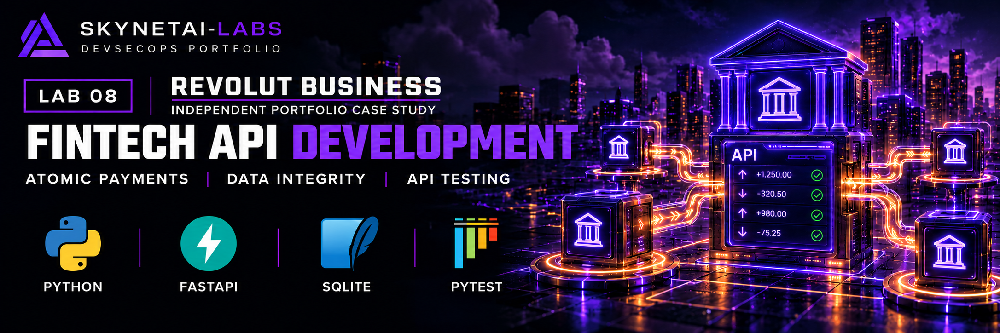
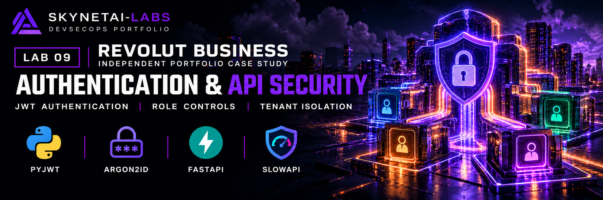
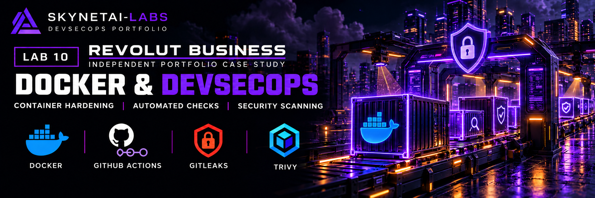
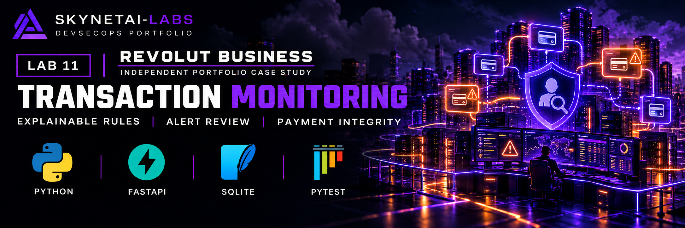

# Revolut Business — Fintech API, Security & GTM Portfolio

**Developer:** SkynetAI-Labs
**Project type:** Independent fintech engineering and commercial strategy case study
**Status:** Labs 1–5 completed; technical checks passed and Lab 5 research and hypothetical GTM strategy published

> Independent educational simulation. Not affiliated with, endorsed by, or connected to Revolut. All customers, accounts and transactions are fictional.

## Project Overview

A five-lab portfolio combining fintech engineering, application security, DevSecOps, transaction monitoring and commercial strategy relevant to UK SMEs.

| Portfolio lab | Internal project lab | Focus |
|---|---|---|
| 8 | 1 | Business Banking API |
| 9 | 2 | Authentication and API Security |
| 10 | 3 | Docker, GitHub Actions and DevSecOps |
| 11 | 4 | Fraud Detection and Transaction Monitoring |
| 12 | 5 | Business Market Intelligence and GTM Strategy |

These phases share one repository. Test counts refer to the combined project suite, not separate suites to be added together.

## Lab 1 — Business Banking API

Implemented:

- FastAPI application with interactive OpenAPI documentation
- SQLite database with fictional business customers and GBP accounts
- Customer, account balance and transaction history retrieval
- Internal payment service for simulated transfers
- Parameterised SQL and foreign-key enforcement
- Non-negative balance constraints
- Atomic transfers and transaction rollback
- Insufficient-funds and currency compatibility checks
- Rejection of invalid amounts, same-account transfers and nonexistent accounts
- Strict positive integer inputs for account IDs and pence amounts, including rejection of booleans, fractions, strings and values outside SQLite's signed-integer range
- Automated API and payment integrity tests

Payment execution is an internal Python service, with no public HTTP payment endpoint.

The initial API milestone passed 11 tests. The combined suite expanded to 38 tests during Lab 2 and 200 tests during Lab 4.

## Lab 2 — Authentication and API Security

Implemented:

- Signed JWT access tokens with required expiry and subject claims
- Token expiry and signature validation
- Database checks confirming authenticated users exist
- Administrator role checks
- Customer and account queries scoped to the authenticated customer
- Transaction queries restricted to transfers involving the customer's accounts
- Argon2id password hashing and password verification
- Internal registration and credential-authentication helpers
- Minimum 12-character registration passwords
- Standard user role assigned on registration
- IP-based request limits
- Security response headers

Implemented roles are `admin` and `user`.

Security headers:

- `X-Content-Type-Options: nosniff`
- `X-Frame-Options: DENY`
- `Referrer-Policy: no-referrer`

Registration, credential authentication and token creation are internal Python helpers. Public registration and login HTTP endpoints are not implemented.

## Lab 3 — Docker, GitHub Actions and DevSecOps

Implemented:

- Separate runtime and development dependency manifests
- Exact version pins for declared direct dependencies
- Test JWT configuration using a fresh generated secret per pytest process
- Fresh-environment installation and test verification
- Successful tests from an isolated project copy without the local `.env` or banking database
- Python 3.14.9 Alpine container with a digest-pinned base image
- Binary-wheel-only runtime dependency installation and dependency consistency checking
- Removal of pip and ensurepip after runtime dependency installation
- Non-root application execution as UID/GID 10001
- Build-context exclusions for secrets, local databases, virtual environments, caches and development files
- GitHub Actions testing and automated security checks

The workflow runs on pushes to `main`, pull requests targeting `main` and manual dispatch. It uses read-only repository-content permissions and disables persisted checkout credentials.

Workflow checks:

1. Install dependencies and check consistency
2. Run the full test suite
3. Scan application source with Bandit
4. Audit installed Python packages with pip-audit
5. Scan checked-out repository files with Gitleaks
6. Build and export the application image
7. Scan the image with Trivy

The workflow builds an image for verification; it does not publish the image.

### Vulnerability Remediation

The original Debian image failed container scanning with 101 HIGH and 3 CRITICAL package findings. Updated Debian and alternative Bookworm candidates also failed evaluation.

The selected Alpine base reported no HIGH/CRITICAL operating-system findings. Four remaining HIGH Python findings were traced to pip's bundled libraries. The runtime image excludes installed pip and its ensurepip installation archive after dependency installation.

The completed Lab 3 candidate reported zero HIGH/CRITICAL findings. No explicit vulnerability exceptions or reduced thresholds were introduced.

GitHub verification passed for remediation commit `d2ff68f` and documentation commit `d3c675a`.

## Lab 4 — Fraud Detection and Transaction Monitoring

Implemented and locally tested:

- Four explainable transaction-monitoring rules
- Configurable thresholds through `MonitoringConfig`
- Persistent alerts linked to transactions and the sender's customer
- Structured evidence containing observed values, thresholds and rule version
- Transaction and detection timestamps
- Atomic integration with the internal payment service
- Bounded historical-analysis batches with resumable transaction-ID cursors
- Duplicate prevention using a unique transaction/rule constraint
- Authenticated customer-scoped alert retrieval
- Administrator alert retrieval and final review decisions
- Validated filters, pagination and route rate limits
- Automated detection, integrity, replay and API security tests

Alerts indicate rule matches for review, not confirmed fraud. Matching a rule does not itself block a transfer.

### Detection Rules

| Reason code | Severity | Alert condition |
|---|---|---|
| `LARGE_TRANSFER` | Medium | Single GBP transfer greater than £5,000 |
| `HIGH_TRANSFER_FREQUENCY` | Medium | More than 5 outgoing transfers from one account within 10 minutes |
| `HIGH_OUTGOING_VALUE` | High | GBP outgoing total greater than £10,000 from one account within 60 minutes |
| `RAPID_REPEATED_TRANSFERS` | High | More than 3 transfers from one sender account to the same recipient account within 5 minutes |

These are educational demonstration thresholds, not banking-industry standards.

Amount rules use integer pence and apply to GBP only. Frequency rules count successful outgoing transfers from the sender account.

The triggering transfer is included. Time-window lower boundaries are inclusive. Later transactions are excluded; equal timestamps are ordered by transaction ID. Naive SQLite timestamps are interpreted as UTC, and timezone-aware timestamps are normalised to UTC.

Threshold overrides are supported through Python configuration objects. A public configuration endpoint and environment-variable threshold loader are not implemented.

### Payment Integrity

Monitoring runs after transaction insertion and before the payment commit, using the same database connection.

- Successful payments and their alerts commit together.
- Rejected transfers do not invoke monitoring.
- A monitoring error rolls back balance changes, the transaction and any inserted alerts.
- A suspicious-pattern match alone does not reject the payment.

This deliberately makes monitoring availability a dependency of payment completion.

### Alert Ownership and Evidence

Customer ownership is derived from the sender account, not a client-supplied customer identifier.

Alerts store:

- Transaction and customer references
- Rule code and severity
- Structured detection evidence and configuration values
- Original transaction time and detection time
- Review status, reviewer and review time

Customer responses omit customer IDs, account IDs and administrator review identities. Administrator responses include customer ownership and review metadata.

### Review Workflow

New alerts are `open`. Administrators can make one final decision:

- `open` → `reviewed`
- `open` → `dismissed`

Decisions record the authenticated administrator and a UTC timestamp. Review updates preserve original detection evidence.

Requests attempting to change a final decision return 409. Missing alerts return 404. Invalid statuses, identifiers or extra body fields are rejected.

Review updates use an explicit write transaction and conditionally update only an open alert. Reopening and changing final decisions are outside scope.

### Historical Analysis

`analyse_historical_transactions()` in `app/monitoring.py` supports:

- An explicit caller-owned database transaction
- Batches of 1–1000 transactions, defaulting to 100
- `after_id` pagination and a fixed `up_to_id` boundary
- Original transaction-time assessment
- Duplicate-safe replay without resetting review decisions
- Caller-controlled commit or rollback

Callers should retain the returned `up_to_id` across a replay and commit each successful batch. On errors, callers must roll back the batch.

This is an internal Python helper, not a public HTTP endpoint or scheduled background worker.

## API Endpoints

| Method | Endpoint | Access | Purpose |
|---|---|---|---|
| GET | `/` | Public | Project information |
| GET | `/health` | Public | Health check |
| GET | `/customers` | Bearer token | Authenticated customer's record |
| GET | `/accounts` | Bearer token | Authenticated customer's accounts |
| GET | `/transactions` | Bearer token | Transfers involving the customer's accounts |
| GET | `/admin/security-status` | Administrator | Demonstration administrator route |
| GET | `/monitoring/alerts` | Bearer token | Authenticated customer's alerts |
| GET | `/monitoring/admin/alerts` | Administrator | Alert retrieval across customers |
| PATCH | `/monitoring/admin/alerts/{alert_id}/review` | Administrator | Final review decision |

Protected requests require an `Authorization: Bearer <token>` header.

Alert list filters:

- `status`: `open`, `reviewed` or `dismissed`
- `severity`: `medium` or `high`
- `rule_code`: one of the four implemented reason codes
- `limit`: 1–100, default 50
- `before_id`: positive alert-ID cursor for the next page
- `customer_id`: positive ID, available only on the administrator listing

Lists return newest alert IDs first. For the next page, pass the last returned ID as `before_id`.

Review request body:

    {"status": "reviewed"}

The alternative decision is `dismissed`. Extra body fields are forbidden.

### Rate Limits

Limits use remote-address keys and in-memory storage.

| Routes | Limit |
|---|---|
| `/`, `/health` | 60/minute each |
| `/customers`, `/accounts` | 30/minute each |
| `/transactions` | 20/minute |
| `/admin/security-status` | 10/minute |
| `/monitoring/alerts` | 30/minute |
| `/monitoring/admin/alerts` | 10/minute |
| `/monitoring/admin/alerts/{alert_id}/review` | 10/minute |

## Technology Stack

Python, FastAPI, Pydantic, SQLite, PyJWT, python-dotenv, pwdlib with Argon2 support, SlowAPI, Uvicorn, pytest, HTTPX, Docker, Alpine Linux, GitHub Actions, Bandit, pip-audit, Gitleaks and Trivy.

CI and the container use Python 3.14.9. The verified local Ubuntu environment uses Python 3.14.4.

## Local Setup

Run commands from the repository root in a Python virtual environment.

Install runtime dependencies:

    python -m pip install -r requirements.txt

For tests and development tools:

    python -m pip install -r requirements-dev.txt
    python -m pip check

Direct dependencies are pinned. Transitive dependencies are not fully locked or hash-pinned.

Configure a private `.env` file with:

- `JWT_SECRET_KEY`: a securely generated signing secret
- `JWT_ALGORITHM`: `HS256`
- `JWT_EXPIRE_MINUTES`: `30`

Never commit the secret or `.env`. Preserve existing local configuration when continuing the project.

Initialise or extend the database schema:

    python -m app.models

The initializer adds monitoring storage without replacing existing banking tables. Run it before using Lab 4 against an older database. Repeatable initialization and preservation of existing records were tested with temporary databases.

Fictional customers, accounts and users require separate setup. Schema initialization does not seed them.

Start locally:

    python -m uvicorn app.main:app --host 127.0.0.1 --port 8000

API documentation while running:

http://127.0.0.1:8000/docs

## Container Usage

Build:

    docker build -t revolut-fintech-api:local .

In the verified Ubuntu/WSL environment, inherited Docker DNS failed. Local builds used:

    docker build --network=host -t revolut-fintech-api:local .

Lab 3 GitHub builds passed with the standard command. The workaround does not change runtime networking.

Start with local configuration:

    docker run -d --name revolut-fintech-api --env-file .env -p 127.0.0.1:8000:8000 revolut-fintech-api:local

Initialise schema inside the running container:

    docker exec revolut-fintech-api python -m app.models

The image excludes the local database and `.env`. Configuration is supplied at runtime.

Database changes remain in the container's writable layer unless persistence is configured. Removing the container loses those changes.

The health route does not check database readiness. Banking and monitoring routes require initialized schema and appropriate fictional records.

The final runtime intentionally has no pip or ensurepip. Change dependency manifests and rebuild the image.

Lab 3 runtime checks verified health, unauthenticated rejection, security headers, UID/GID 10001 and graceful shutdown. Lab 4's updated image was built and scanned locally; new route behaviour was verified through isolated API tests.

## Automated Testing

Run:

    python -m pytest tests -q

`tests/conftest.py` supplies test JWT settings before application imports. Database-dependent tests use temporary SQLite fixtures.

**Latest verified Lab 4 local result: 200 passed, 10 dependency deprecation warnings — 22 October 2026.**

Coverage includes:

- Existing API, authentication, registration and payment behaviour
- JWT expiry, signature checks and required claims
- Administrator access and customer isolation
- Threshold boundaries and configuration validation
- Time-window boundaries, UTC offsets and transaction ordering
- Sender and recipient scoping
- Alert schema constraints and duplicate prevention
- Historical replay, pagination boundaries and rollback
- Payment and alert atomicity during monitoring failure
- Customer response privacy and administrator alert access
- Validated filters, pagination and rate limits
- Review permissions, recorded decisions and protected evidence

Historical milestones: Lab 1 passed 11 tests; Labs 2–3 passed the expanded 38-test suite. Lab 3 also verified its suite in a fresh environment, an isolated source copy and an Alpine compatibility container.

Current warnings concern Starlette's HTTPX TestClient integration and SlowAPI's deprecated asyncio API usage. They remain unresolved.

## Security Verification

### Lab 4 Local Evidence

| Check | Result |
|---|---|
| Full test suite | 200 passed, 10 warnings |
| Bandit application scan | No issues identified; no skipped files or suppressed lines |
| pip-audit | No known vulnerabilities found |
| Gitleaks application-directory scan | No leaks found |
| Gitleaks tests-directory scan | No leaks found |
| Docker build | Passed; local image `e62df17aba27` |
| Trivy completed-image scan | Zero HIGH/CRITICAL findings across scanned OS and Python packages |
| Lab 4 GitHub workflow | Passed for commit `72d40c3`; verified 23 October 2026 |

Workflow scanner versions include Gitleaks 8.30.1 and Trivy 0.76.1. Local Gitleaks uses the separately installed CLI.

Trivy fails on HIGH/CRITICAL vulnerabilities, including unfixed findings. No explicit vulnerability exceptions were added. Results reflect the vulnerability database at scan time.

Trivy emitted a third-party SBOM accuracy warning. Passing scans do not guarantee every component or vulnerability was detected.

Local checks:

    python -m bandit -r app
    python -m pip_audit
    gitleaks detect --no-git --source app --redact
    gitleaks detect --no-git --source tests --redact
    gitleaks protect --staged --redact
    git diff --cached --check

Directory scans, staged scans and the workflow's checked-out-file scan do not establish that the entire Git history is free of secrets.

## Current Limitations

This is an educational prototype, not a production banking or fraud-prevention system.

- Rule matches do not prove fraud; demonstration thresholds can produce false positives and miss suspicious activity.
- No machine learning, automatic blocking, external banking integration or public payment endpoint.
- Public login/registration, token revocation, refresh tokens and MFA are not implemented.
- Amount rules cover GBP only.
- Historical assessment relies on current sender-account ownership and currency; the transaction table does not preserve historical snapshots of those attributes.
- Historical analysis requires caller-controlled execution; no scheduled monitoring worker exists.
- Assessment reads the sender's transaction history into memory. Bounded replay batches do not bound that per-assessment history read.
- Malformed historical timestamps can stop assessment and require investigation.
- Monitoring errors roll back payments, coupling payment availability to monitoring.
- Review decisions are final; there is no reopening flow or separate review-event history.
- SQLite and in-memory rate limiting are demonstration choices with scaling limitations.
- Direct dependency pins do not provide a complete transitive lockfile.
- Database initialization, fictional data seeding and persistence require explicit setup.
- Dependency warnings, the local Docker DNS workaround and legacy-builder notice remain documented.
- Sequential CI steps can prevent later checks from running after an earlier failure.
- Security results are point-in-time evidence; future runs may report new findings.
- Commercial research and a hypothetical GTM strategy are published; complete cross-border quotes and customer validation remain outstanding.

Passing tests and scans demonstrate the checks performed; they do not establish production readiness. Use fictional data only.

## Lab 5 — Market Intelligence and GTM Strategy

**Status:** Research and strategy case study published; GitHub checks passed for `9ab86f9`.

[Read the complete GTM case study](docs/gtm/README.md).

Prepared:

- UK SME market context and a dated source register.
- Revolut Business product, pricing and eligibility analysis.
- Competitor comparison covering Wise, Starling and HSBC.
- Scenario pricing with unresolved cross-border costs identified.
- Assumption-based segment scoring and sensitivity analysis.
- A provisional agency ICP, positioning and buyer messaging.
- Draft discovery materials and a hypothetical 90-day pilot.
- A resource, funnel and acquisition-cost model with risk controls.

The model assumes 75 hours and GBP150 direct cash, producing GBP2,400
economic cost at an assumed GBP30 hourly value. Its base case produces
two expected activations; these are hypothetical values, not results.

No interviews, outreach, campaigns or customer acquisitions were
conducted. No provider partnership or commission is assumed.
Customer demand, complete cross-border costs and commercial viability
remain unvalidated.

## Development Roadmap

| Lab | Focus | Status |
|---|---|---|
| 1 | Business Banking API | Completed |
| 2 | Authentication and API Security | Completed |
| 3 | Docker, GitHub Actions and DevSecOps | Completed; GitHub verification passed |
| 4 | Fraud Detection and Transaction Monitoring | Completed; GitHub verification passed for `72d40c3` |
| 5 | Revolut Business Market Intelligence and GTM | Completed; case study published and GitHub checks passed for `9ab86f9` |

## Project Disclaimer

Independent educational portfolio project developed by SkynetAI-Labs.

Not affiliated with or endorsed by Revolut. No real banking systems, customer data or funds are used.

## Portfolio Labs 08–12 Audit — 24 October 2026

See [AUDIT_LABS_08_12.md](AUDIT_LABS_08_12.md) for the five phase-by-phase audit results, reproduced payment-input defect and fix, source checks, open recommendations and verification boundaries.

The historical 200-test result above is retained. This audit adds 31 payment-input and balance-integrity regression cases. [Verification run 40136285242](https://github.com/SkynetAI-Labs/Revolut-fintech-api-security-case-study/actions/runs/40136285242) passed with **231 tests and 10 dependency deprecation warnings**, plus Bandit, pip-audit, Gitleaks, Docker build and the configured Trivy scan. Later documentation commits have their own checks in [PR #1](https://github.com/SkynetAI-Labs/Revolut-fintech-api-security-case-study/pull/1). Passing technical checks does not validate commercial assumptions.
